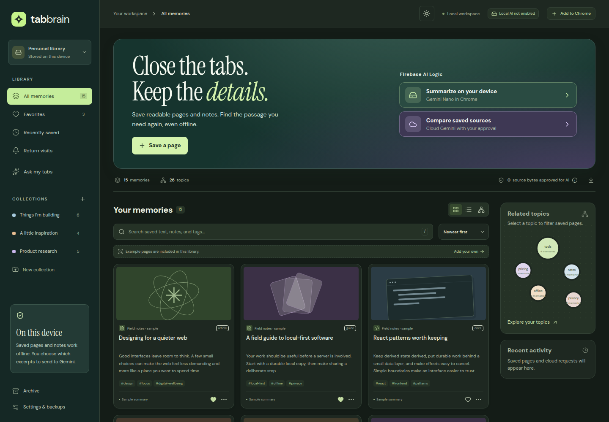

# Tab Brain

Save the text from your Chrome tabs. Find it after you close them, even offline.

[Open Tab Brain](https://tab-brain-memory.vercel.app) · [Download the Chrome extension](https://tab-brain-memory.vercel.app/downloads/tab-brain-extension.zip) · [Follow the demo steps](docs/testing-the-app.md)



## Why tabs pile up

You're comparing four tools for a project. One page has the price, another explains how offline editing works, and a third is worth reading later. A bookmark keeps the address. You still have to reopen the page and find the passage that mattered.

Tab Brain saves readable text, your notes, and the original link in a library on your device. Close the tabs after the extension confirms the save. When you come back, search for a phrase you remember or set a reminder for the page you want to finish.

## From open tabs to an answer

1. In the Chrome side panel, choose the tabs you want to save. On the website, start with the labelled sample library or paste text through **Save a page**.
2. On supported desktop Chrome, enable on-device summaries. Gemini Nano adds a short summary and three topic tags to the original text.
3. In the extension, choose **Close saved tabs** after the save is confirmed. Pinned tabs and tabs that changed during capture stay open.
4. Search for an exact detail such as `full offline editing`. Open the saved passage, add a note, or schedule a return visit. The library stays searchable offline.
5. Open **Ask my tabs**, select sources, and review the actual excerpts. Approve the request to get a Gemini answer with links back to the original pages. Download it as a Markdown brief.

[Try the complete workflow](docs/testing-the-app.md) · [See the other features](docs/features.md)

## How Firebase fits

Firebase AI Logic gives Tab Brain one SDK for Chrome's on-device Gemini Nano and a cloud Gemini model. Each task uses a fixed inference mode so a local summary stays on the device.

**While you save a page**, Firebase AI Logic calls Gemini Nano in Chrome with device-only inference. Chrome processes the page on your device. Tab Brain keeps the original text and labels a summary once the SDK reports that it ran on-device.

**When you compare pages**, Firebase AI Logic uses the cloud Gemini model. Firebase App Check verifies the browser before the request. You see the excerpts before approving them, and personal notes stay in your library. The answer keeps its model, source links, and capture dates.

[How it works](docs/architecture.md) · [Firebase and Chrome setup](docs/firebase-setup.md) · [What was tested](docs/validation.md) · [Data and backups](docs/privacy.md)

## Browser and service requirements

The extension reads tabs you choose. On the website, paste the text or try the sample library. Gemini Nano needs supported desktop Chrome and an initial model download. Saved text, notes, and search work offline. Cloud comparisons need an internet connection and browser verification from Firebase App Check. The reading brief can be downloaded without an account. Scheduled email delivery needs a configured sender and Firebase backend. [Current test results](docs/validation.md) · [Email setup](docs/email-setup.md)

## Run it locally

Use Node 24 and Python 3.

```sh
npm ci
npm run dev
```

`npm run build` builds the website, the unpacked extension, and both download bundles. `npm test` runs the unit tests. [Install the extension or run the browser checks](docs/get-started.md).

[Apache-2.0 license](LICENSE) · [Hackathon notes](docs/submission.md)
