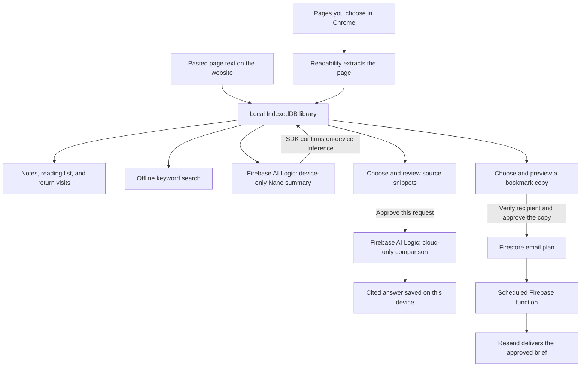

# How Tab Brain works

A saved link often loses the reason you kept it. Tab Brain keeps the readable text, your own notes, and a way to revisit the page. The library lives in the browser, so saving and finding a detail do not depend on an account or an AI request.

## From an open tab to a useful memory

The Chrome side panel asks which tabs to capture. After confirmation, the extension injects the reader into eligible HTTP and HTTPS pages. Mozilla Readability extracts article text. The web companion offers pasted text capture because a website cannot read your other tabs.

The app creates a memory with the source URL, title, text, excerpts, and topic tags. It waits for the IndexedDB transaction to finish before reporting a save. A failed write leaves the tabs open. When you choose to close saved tabs, the extension checks the persisted record and the tab’s current URL again. Pinned or changed tabs remain open.

The email branch is optional and disabled on the public deployment until the sender and Firebase services are configured.

## The two AI operations

The capture model uses `InferenceMode.ONLY_ON_DEVICE` and can run before a user connects a cloud project. A button gives Chrome the user interaction it needs to initialize the device model. The app checks `InferenceSource.ON_DEVICE`, validates the summary structure, and keeps excerpts found verbatim in the saved text. Unsupported devices save readable excerpts.

Comparisons use a separate `InferenceMode.ONLY_IN_CLOUD` model. Local search selects candidate memories. The preview contains their titles, URLs, capture dates, short summaries, and relevant excerpts. You can remove a source before sending. The send operation uses an immutable copy of the reviewed payload and checks that it matches the approved request. It obtains an App Check token before invoking the model. If browser verification fails, the source text stays local. Settings can verify App Check separately without generating an answer.

The Firebase SDK must report cloud inference before the answer is saved. The answer must also cite approved source numbers. These checks establish where the model ran and which citations it used. They cannot establish the truth of every generated sentence.

The live badge follows SDK initialization, generation, approval, completion, and failure. Saved AI results record the requested model name, confirmed inference location, and verification time. Imported summaries are labelled as imported; an imported receipt is not treated as evidence of a new model run.

## Making time to read

Notes, reading status, and reminder dates belong to the local memory. Search includes private notes, but AI source previews and email copies exclude them. Capturing the same URL again preserves these personal fields.

Return visits separates due reminders, upcoming reminders, and unread pages. A reminder stays due until you mark the page as read, remove the reminder, or reschedule it. Its notification receipt prevents another open window from announcing the same reminder again. A changed reminder date can be announced again.

The extension schedules Chrome alarms and handles them in its background worker. The website checks due reminders while it is open. A calendar download contains a timed event and alert, with UTC timestamps and escaped text.

## Email that works when the browser is closed

The local browser cannot send a reliable daily email after it closes. The email feature therefore stores a small, approved copy in Firestore. It contains up to 100 bookmark titles and URLs, optional short summaries, and optional reminder dates. It contains neither full captured pages nor private notes.

Firebase Authentication verifies the recipient. The functions derive the address from the authenticated identity and check the account again before delivery. The client cannot supply a different recipient. App Check protects the callable functions, and Firestore rules deny direct client access to email plans.

A scheduled function checks due plans every 15 minutes. A Firestore transaction claims each delivery with a ten-minute lease. Retries keep the same message and Resend idempotency key. Permanent errors, four failed attempts, or an uncertain request older than twelve hours pause the plan. Successful delivery records the provider receipt, advances the digest schedule, and marks the included reminder dates as sent.

A saved plan waits at least an hour before starting a different email, even if you edit the plan while delivery is in progress. A retry of the same pending email keeps its original provider key. Daily and weekly times follow the chosen time zone. If a clock change removes the chosen local hour, delivery moves to the next valid time that day. A repeated local hour produces one scheduled brief.

Deleting or changing a plan cancels a queued delivery before its final transport check. A request already in flight can still arrive. The unsubscribe page asks for confirmation on a normal GET, while a one-click unsubscribe POST removes the plan. This keeps email link previews from cancelling a subscription automatically.

## Where to find the code

| Part | Location |
| --- | --- |
| Capture, saved records, search, and backups | `src/library.ts`, `src/db.ts`, and `src/extension.ts` |
| The model calls and visible activity | `src/ai.ts`, `src/aiStatus.ts`, and `src/components/ModelBadge.tsx` |
| Notes, reminder editing, and the reading queue | `src/components/DetailModal.tsx`, `src/components/ReminderPanel.tsx`, and `src/components/ReturnView.tsx` |
| Chrome alarms and background notifications | `src/extensionReminders.ts` and `extension/background.ts` |
| Email preview and approved data format | `src/components/EmailsView.tsx` and `shared/email.ts` |
| Authentication, schedules, delivery leases, and unsubscribe | `functions/src/` |
| Database access and indexes | `firestore.rules` and `firestore.indexes.json` |

The web app and extension use separate origins and databases. There is no automatic library sync between them. A backup is the deliberate way to move a library to another browser.
